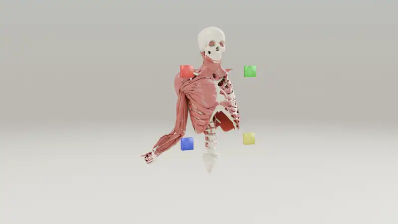
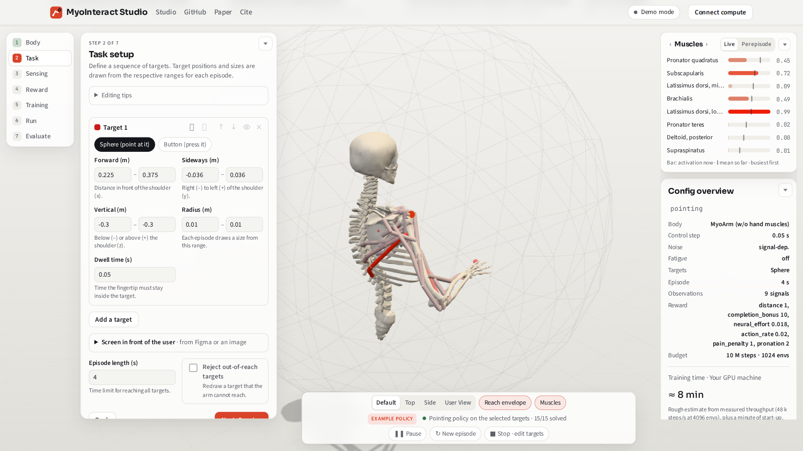

<h1 align="center">MyoInteract</h1>
<p align="center"><b>Train a musculoskeletal arm to use your interface: set up the task in a browser, press train, watch it learn.</b></p>

<p align="center">
  <a href="https://myointeract.github.io/studio/"><b>▶ Open MyoInteract Studio</b></a> ·
  <a href="https://doi.org/10.1145/3800645.3812899">Paper (DIS 2026)</a> ·
  <a href="#quickstart">Install</a>
</p>

<p align="center">
  <a href="https://myointeract.github.io/studio/promo.mp4"></a>
</p>

MyoInteract is the stable, maintained release (v1.0) of the framework introduced in

> Ankit Bhattarai, Hannah Selder, Florian Fischer, Arthur Fleig and Per Ola Kristensson.
> **MyoInteract: A Framework for Fast Prototyping of Biomechanical HCI Tasks using Reinforcement Learning.**
> Proceedings of the 2026 Designing Interactive Systems Conference (DIS '26), 2829–2851. [doi:10.1145/3800645.3812899](https://doi.org/10.1145/3800645.3812899)

If you use it, please [cite the paper](#citation).

## What it is for

Biomechanical simulations driven by reinforcement learning can predict how people move when they use an
interface: how long a reach takes, which muscles work, when the arm tires. In practice they have been hard to
set up, slow to train and hard to interpret, which keeps them out of the design process.

With MyoInteract, a designer can run such a simulation in one go. The task (what to reach or
press, and where), the user model (a muscle-driven arm and hand) and the training settings are set up in a graphical
interface, and thousands of simulated users train in parallel on a GPU, so a policy is ready in minutes
instead of hours or days. In the paper, we report training times reduced by up to 98% and insights from a workshop in which
interaction designers with no prior experience were able to set up, train and assess goal-directed movements within a
single session.

It builds on [MyoSuite](https://github.com/MyoHub/myosuite) (musculoskeletal models and tasks) and trains with
[mjlab](https://github.com/mujocolab/mjlab) on MuJoCo Warp (PPO).

## What is in this repository

<p align="center"><a href="https://myointeract.github.io/studio/"></a></p>

| | |
|---|---|
| **Studio** (`myoInteract/studio/`) | The guided web app: body, task, sensing, reward, training and evaluation using an interactive 3D viewer, with Figma frames as optional task screens. Hosted at [myointeract.github.io/studio](https://myointeract.github.io/studio/); `myo_studio serve` adds training on your GPU |
| **Tasks and user models** (`myoInteract/`, `myo_user/`) | Pointing and button tasks, single or in sequence, for the MoBL-ARMS and MyoArm models, with optional muscle fatigue (experimental) and motor noise |
| **Training and playback** (`myo_train`, `myo_play`) | Command-line training with ONNX checkpoints, and the Gradio task builder of the paper |
| **Configurations** (`myo_config/`) | Hydra configs and the presets shared by Studio, the Gradio task builder and the command line |
| **Example policies** (`myoInteract/studio/examples/`) | One trained policy per task example, including a recorded rollout |
| **Tutorials** (`tutorials/myointeract/`) | Notebooks hosting the Gradio interface from the paper and Studio for use with Colab |

## New in v1.0 since the paper

The paper's code is the beta version, kept on the [`beta` branch](https://github.com/MyoInteract/MyoInteract/tree/beta)
of this repository (**deprecated** and not maintained). It runs on MJX (JAX and Brax) instead of mjlab, in case you
need that backend. This release adds:

- **MyoInteract Studio**, a web app that replaces the notebook as the main entry point: targets are placed and
  resized directly in a 3D scene of the body model, and training curves, a live view of the policy and
  evaluation sit in the same page.
- **Figma integration.** Paste the link of a Figma frame and it appears as a screen in front of the simulated
  user; its buttons and other controls become targets with the size, place and orientation they have in the
  design, and stay on the screen when you move it. A design goes from Figma to a trained user model without
  rebuilding it by hand. Alternatively, you can upload a screenshot of your UI for reference.
- **Policies that run in the browser.** The hosted page plays the example policies itself (MuJoCo compiled to
  WebAssembly), on their own task or on targets you manually set, without any installation.
- **An installable package on MyoSuite 3.** `pip install` replaces the forked MyoSuite checkout and conda
  environment of the beta; MyoInteract uses the released `myosuite` through its public API.
- **More user models:** MyoArm with and without hand muscles, next to the MoBL-ARMS models.
- **More places to train:** your own machine, a lab server through an SSH tunnel, Google Colab
  (`tutorials/myointeract/studio_colab.ipynb`) or a Docker Space in your own Hugging Face account
  (`hf_space_studio/`).
- **Export:** the task as a MuJoCo model, with a connected backend.

## Authors and acknowledgements

MyoInteract is a tool created by **Ankit Bhattarai, Hannah Selder, Florian Fischer, Arthur Fleig and Per Ola
Kristensson**, and currently maintained by Florian Fischer. Many thanks to all providing highly valuable feedback over the last year!

## Quickstart

```bash
pip install "myoInteract[all] @ git+https://github.com/MyoInteract/MyoInteract.git@v1.0.0"

myo_studio serve  # Studio: a guided web app for setup, training and evaluation
myo_play          # or the Gradio task builder
myo_train --help  # or train from the command line
```

Extras: `ui` (Gradio), `mjlab` (GPU training stack), `rl` (Weights & Biases, optional), `studio` (Studio backend), `all` (all of them),
`colab` (what Colab installs). The configs and models
(`myo_config/`, `myo_user/`) are part of the package. When you run the UI from a pip install, checkpoints
and logs go to `$MYOINTERACT_HOME` (default `./myoInteract_data`); training logs to tensorboard unless
you set `MYOINTERACT_LOGGER=wandb`.

CPU Studio, scene preview and MJCF export accept `mujoco>=3.11,<4`, including
MuJoCo 3.17. To use the newer engine without training dependencies, install in a
separate virtual environment:

```bash
pip install "myoInteract[studio] @ git+https://github.com/MyoInteract/MyoInteract.git@v1.0.0" "mujoco==3.17.0"
myo_studio serve
```

The `mjlab`/`all` training extras let the backend choose its compatible MuJoCo and
MuJoCo-Warp pair. Published mjlab 1.6 currently requires both at 3.11.x; upgrading
that environment to 3.17 requires a compatible backend release. The browser runs
its bundled WASM engine (3.15.0) independently of the installed Python engine.
Engine upgrades can change tendon/contact dynamics and policy outcomes; exact
trajectory comparisons use references tagged with the generating engine version.

For development:

```bash
git clone https://github.com/MyoInteract/MyoInteract.git && cd MyoInteract
conda create --name myointeract python=3.13 && conda activate myointeract
pip install -e ".[all]"
```

**Studio** (`myo_studio serve`, then http://localhost:8000) guides you through the body model, task setup,
observation space, reward and training settings, next to an interactive 3D viewer of the simulated user (the
same MuJoCo model that is used for training). Targets and their sampling areas can be dragged in 3D or set by
typing ranges, and can be checked from the simulated user's point of view. A Figma frame can be placed in
front of the user, with its controls becoming targets; alternatively, you can upload a screenshot of your UI
for reference. Studio runs `myo_train` in the background and shows the training curves, evaluates any
checkpoint, vision policies included (success rate, time to success, effort, fatigue), and plays a policy
live in the 3D viewer, using the latest checkpoint during training. The task can be exported as a MuJoCo
model zip (e.g. for MuJoCo's Unity plug-in). It listens on localhost only; on a remote GPU server use
`ssh -L 8000:localhost:8000` and `myo_studio serve --no-browser` (the live view is served through the same
port, under `/viewer/`). Presets are the same files as in the Gradio UI.

The Evaluate step lists **example policies**, one per bundled task example, trained on MyoArm (w/o hand muscles)
(`myoInteract/studio/examples/`): load one to watch it live, evaluate it again or open its task. The hosted
page shows their stored results and replays a recorded rollout without any backend. To make a finished run a
permanent example, run `python -m myoInteract.studio.examples --run <log dir> --name <task example>`.

To test a policy **out of distribution**, set Evaluate's *Task* to "Setup in the editor": the run's policy is
evaluated and played on the targets (and episode length) set in the editor, while its body model, timing and
observations stay as trained (Studio refuses setups that change them); any deviations from the training setup are listed in the result overview.

Behind a proxy that already restricts access (Colab's port proxy, a private Space), start Studio with
`--behind-proxy`: it then asks for no pairing code. `myoInteract.studio.colab.launch()` does this on Colab.

Prefer a notebook? `tutorials/myointeract/myoInteract.ipynb` starts the UI, lets you preview a task and launches the training.

Continue an ONNX training bundle with the same task and network configuration:

```bash
myo_train --config my_task.json --resume-checkpoint path/to/model_stopped.onnx --agent.max-iterations 500
# Or explicitly add another 50 updates to the checkpoint's completed count:
myo_train --config my_task.json --resume-checkpoint path/to/model_final.onnx --additional-iterations 50
```

`--agent.max-iterations` is the desired total, including restored updates. Continuation
restores the native optimizer, models, normalizers and curriculum counter; simulator,
task, fatigue and RNG state start fresh, so this does not reproduce an uninterrupted
trajectory. Ctrl+C or Studio's Stop waits for the current learner update and writes
`model_stopped.onnx`; `lifecycle.json` records completion, stopping or failure. To change
the timing (`env.ctrl_dt`, `env.sim_dt` or the episode length `env.task_config.max_duration`),
add it to the `extra_overrides` list of the config file rather than passing it on the command
line: the timing is then stored with the checkpoint, so evaluation uses the same timing as training.

## Requirements

| | |
|---|---|
| Python | 3.10 – 3.13 for training and the UI (mjlab does not support 3.14 yet); MyoSuite itself runs on 3.10 – 3.14 |
| GPU | NVIDIA, for training. CPU works for building, previewing and the tests |
| Key packages | `myosuite` (MyoSuite 3), `torch>=2.13`, `mjlab>=1.6`, `mujoco-warp>=3.11`, `gradio>=6,<7` |

**CUDA.** Current PyTorch wheels and Warp need a recent driver. With a driver reporting CUDA 13 or newer the default
`pip install` is enough. With CUDA 12.9, install torch from the `cu129` index first. With a driver limited to
CUDA 12.8, use `torch==2.11.*` from the `cu128` index and `warp-lang<=1.16` (this is below the `torch>=2.13` floor
of the `mjlab` extra, so install it with `--no-deps` afterwards). Older CUDA 12.6 drivers are not supported on Blackwell GPUs.

`myosuite` (3.0.0 or newer) comes from PyPI. To develop against a local MyoSuite checkout, install MyoSuite first
(`pip install -e /path/to/myosuite`) and then install myoInteract via `pip install -e . --no-deps`. An old editable install of the previous
`myosuite` fork must be uninstalled first.

## Layout

| Path | Content |
|---|---|
| `myoInteract/` | package: task registration, configs, UI, training scripts |
| `myoInteract/studio/` | Studio web app (`static/index.html`), its backend (`myo_studio serve`) and the example policies (`examples/`) |
| `hf_space_studio/` | Docker Space template for Studio in your own Hugging Face account |
| `myo_config/` | Hydra task configs (`tasks/`) and UI presets (`gradio_tasks/`) |
| `myo_user/` | MJCF models and assets of the universal task |
| `tests/` | config round trip, MyoSuite 3 compatibility, Studio API and UI component tests |
| `tutorials/myointeract/` | the myoInteract and myoInteract Studio notebooks (local and Colab) |

The release contains the universal pointing / button task (`myoInteractUniversal-v0`).

## Tests

```bash
pip install -e ".[dev]"
pytest tests
```

The suite checks the config round trip, task registration and a short mjlab reset/step against MyoSuite 3,
the `myo_train` CLI, and the two-thumb range slider in a real browser (skipped without Chrome).

## Citation

```bibtex
@inproceedings{bhattarai2026myointeract,
  author={Bhattarai, Ankit and Selder, Hannah and Fischer, Florian and Fleig, Arthur and Kristensson, Per Ola},
  title={MyoInteract: A Framework for Fast Prototyping of Biomechanical HCI Tasks using Reinforcement Learning},
  booktitle={Proceedings of the 2026 Designing Interactive Systems Conference},
  series={DIS '26},
  year={2026},
  pages={2829--2851},
  publisher={Association for Computing Machinery},
  address={New York, NY, USA},
  location={Singapore, Singapore},
  doi={10.1145/3800645.3812899},
  url={https://doi.org/10.1145/3800645.3812899},
}
```

## License

GNU General Public License v3.0, see `LICENSE`. Parts derive from [Ingrim4/myo_user](https://github.com/Ingrim4/myo_user) (MIT). The MyoArm models come from
[myo_sim](https://github.com/MyoHub/myo_sim), the MoBL-ARMS models from [User-in-the-Box](https://github.com/User-in-the-Box/user-in-the-box).
